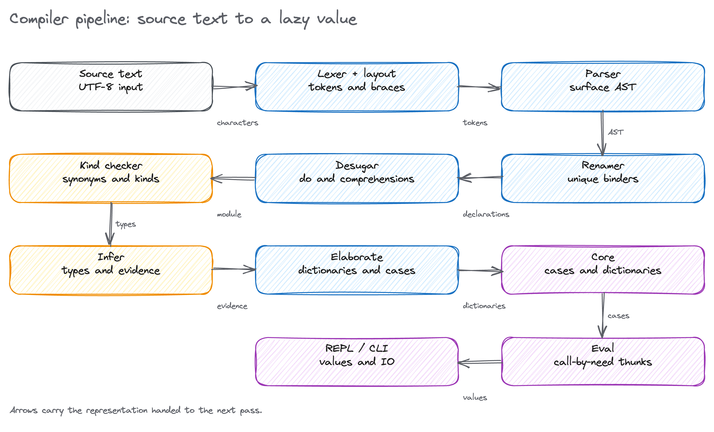
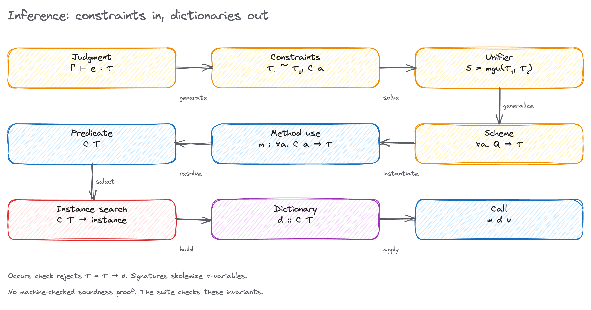
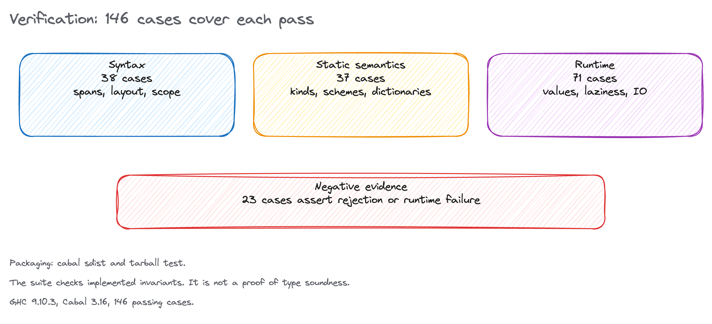

# wyah-compiler

A compiler for ProtoHaskell, the language in Stephen Diehl's *Write You a Haskell*. The compiler resolves names, checks kinds and types, elaborates type-class evidence into dictionaries, lowers the program to a small Core language, and runs Core in a call-by-need interpreter.

The pass boundaries are explicit. Each pass has an input representation, an output representation, and a contract that the next pass can rely on. The implementation starts from source text and ends at a value or an `IO` action. It does not have a native backend.

Current baseline: 146 regression cases pass on GHC 9.10.3. The tarball produced by `cabal sdist` passes the same suite.

## Quick start

```bash
cabal build all
cabal test
cabal run wyah-compiler -- examples/primes.fun
```

The file runner prints the inferred type of `main` and the evaluated value. With no file argument, the executable starts the REPL.

```text
$ cabal run wyah-compiler -- examples/primes.fun
type: [Int]
value: [2, 3, 5, 7, 11, 13, 17, 19, 23, 29]
```



## Pipeline

The compiler has eight passes over four representations. The arrows in the figure name the representation handed to the next pass.

| Pass | Module | Input to output | Contract |
| --- | --- | --- | --- |
| Lex and layout | `WYAH.Lexer` | `Text` to `[Token]` | Inserts virtual braces and semicolons. Tracks bracket depth. |
| Parse | `WYAH.Parser` | `[Token]` to `Module` | Recursive descent with a fixity prepass. Every surface node carries a span. |
| Rename | `WYAH.Renamer` | `Module` to `RModule` | Resolves every name. Groups equations. Adds record selectors. |
| Desugar | `WYAH.Desugar` | `RModule` to `RModule` | Removes `do` notation and list comprehensions. |
| Kind | `WYAH.Kind` | `RModule` to `CheckedModule` | Expands synonyms. Assigns kinds. Builds data, class, and instance environments. |
| Infer | `WYAH.Infer` | `CheckedModule` to `InferredModule` | Solves constraints. Generalizes schemes. Records evidence ids. |
| Elaborate | `WYAH.Elaborate` | `CheckedModule` and `InferredModule` to `CoreModule` | Makes dictionaries explicit. Compiles pattern matches to cases. |
| Evaluate | `WYAH.Eval` | `CoreModule` to `Value` or `IO` | Call-by-need thunks, recursive environments, primitive dispatch. |

`WYAH.Repl` composes the passes, normalizes failures, and provides the REPL and file runner. `WYAH.Prelude` seeds built-in names and schemes. `WYAH.Diagnostic` defines the phase, source, span, and message contract used by every pass.

## Representations

| Representation | Type | What it guarantees |
| --- | --- | --- |
| Surface | `Module` | Syntax is parsed. Names are unresolved. Spans are present. |
| Renamed | `RModule` | Every binder is a module-unique `ResolvedName`. Equations are grouped. Scopes are explicit. |
| Typed | `InferredModule` | Types are canonical. Schemes carry predicates. Every constrained occurrence has an `EvidenceId`. |
| Core | `CoreModule` | Type-class evidence is an explicit argument. Patterns are cases. Source sugar is gone. Spans are gone. |

Core has no source spans. Evaluation errors report the source file and a structured message, with `span=<unknown>`. Parse, rename, kind, and inference errors carry a source span.

## Frontend

The lexer implements the Haskell layout algorithm directly. It tracks indentation contexts for `where`, `let`, `do`, `of`, and `class` blocks, emits virtual braces and semicolons, and suspends layout insertion inside parentheses and brackets. A `where` after a `do` or `of` block closes that block, except when the `where` belongs to a case alternative.

The parser is handwritten. A prepass collects fixity declarations before expressions are parsed, so an operator can be used before its fixity declaration. Expression parsing uses precedence climbing. Patterns, types, guards, and declarations have separate entry points. Parser failures carry the offending token and span, including a zero-width span at end of input.

The renamer assigns every binder a fresh integer. Top-level declarations are mutually recursive. Function equations are grouped before inference. Record fields generate selector functions, including selectors shared by several constructors. The renamer rejects class default methods, instance method signatures, unsupported `deriving`, non-linear patterns, duplicate declarations, and unbound names.

## Kinds and types

Kind inference assigns a metavariable to each data parameter and refines it from constructor field uses. Unresolved metavariables default to `*`. A declaration such as `data T1 f a = T1 (f a)` gives `T1 :: (* -> *) -> * -> *`. Synonyms are expanded before kind checking and must be fully applied.

Types use the canonical form:

```text
Type   = TVariable TVar
       | TConstructor TyCon
       | TApplication Type Type
       | TFunction Type Type
Scheme = Forall [TVar] [Pred] Type
Pred   = Pred { predClass :: Name, predType :: Type }
```



Inference starts from a judgment and generates equality and class constraints. A single substitution is threaded through the pass. Unification runs an occurs check, so `a ~ a -> b` fails instead of building an infinite type. Generalization quantifies type variables that do not occur free in the environment and turns constraints over those variables into predicates on the scheme.

```text
Γ ⊢ e : τ
S = mgu(τ₁, τ₂)
α ∉ ftv(Γ)  =>  Γ ⊢ e : ∀α. τ
```

Signatures are checked by skolemizing their quantified variables. The body is inferred with the signature predicates as givens, then unified with the skolemized type. Instance heads are matched one way. Instance contexts are solved recursively with a depth bound. Duplicate instance heads, bare type-variable heads, context variables outside the head, and instances with missing methods are rejected.

A constrained binding becomes a function of its dictionaries. For example:

```haskell
class Eq2 a where
  eq2 :: a -> a -> Bool

same :: Eq2 a => a -> a -> Bool
same x y = eq2 x y
```

Core represents `same` as a lambda with a dictionary parameter. A call to `eq2` becomes a field selection from that dictionary. Instance dictionaries are values. Superclass dictionaries are fields built during instance elaboration.

```text
same = \dEq2 -> \x -> \y -> eq2 dEq2 x y
```

Arithmetic and comparison primitives are monomorphic over `Int`. User-defined classes exercise the dictionary path. Built-in `IO` is handled by the evaluator rather than by a user-visible `Monad` class.

## Core and evaluation

Core has variables, literals, lambdas, application, non-recursive and recursive lets, cases, constructors, dictionaries, dictionary selection, and structured errors. Elaboration compiles each function equation into a lambda and a chain of cases. A failed match falls through to the next equation; an exhausted chain raises `pattern match failure`.

The evaluator uses `ThunkValue` and `ThunkDelay`. Applications, let bindings, top-level bindings, and dictionary fields are delayed and shared. `CLetRec` ties the recursive environment knot in Haskell. Values include integers, booleans, characters, constructors, closures, primitives, partial constructor applications, dictionaries, and `IO` actions.

`IO` actions are values of type `IO (Either EvalError Value)`. The driver runs the action for `main` or for a REPL expression. `fix` is a primitive. Infinite lists work because constructor fields are thunks and `take` forces only the prefix it needs.

## Verification



The suite has 146 active cases: 98 TSV fixtures and 48 inline structural tests. Of those, 23 assert rejection or a runtime failure. The counts by pass are:

| Pass | Cases | Fixtures | Inline |
| --- | ---: | ---: | ---: |
| Parsing | 30 | 20 | 10 |
| Renaming | 8 | 3 | 5 |
| Kinds | 4 | 2 | 2 |
| Inference | 33 | 24 | 9 |
| Evaluation | 71 | 49 | 22 |
| **Total** | **146** | **98** | **48** |

The parser tests check spans, layout block structure, fixity, sections, ranges, records, GADT syntax, and end-of-input failures. Renaming tests cover shadowing, recursive scope, unbound names, duplicate declarations, and non-linear patterns. Kind tests cover higher-kinded parameters, ill-kinded constructors, and synonym errors. Inference tests cover let-polymorphism, occurs checks, annotations, local signatures, signature mismatches, class schemes, superclasses, and instance contexts. Evaluation tests cover arithmetic, pattern matching, guards, `where`, lazy lists, comprehensions, records, dictionaries, `fix`, `do`, `IO`, and runtime failures.

Every diagnostic uses the same contract:

```text
phase=<phase>; source=<source>; span=<span>; message=<message>
```

`cabal sdist` includes the fixtures, examples, documentation, and figures. The extracted tarball passes `cabal test`.

The suite is evidence about the implementation. It is not a mechanized soundness proof. A formal proof would need a small-step semantics, progress, and preservation for Core; that work is not in this tree. There is also no Core type checker, so elaboration relies on the source-level type checker and the regression suite.

## Language coverage

| Area | Implemented |
| --- | --- |
| Declarations | Function equations, signatures, data declarations in regular and GADT syntax, records with selectors, type synonyms, single-parameter classes, instances, fixity declarations. |
| Expressions | Variables, constructors, literals, lambdas, application, `let`, `if`, `case`, `do`, lists, tuples, ranges, list comprehensions, operator sections, annotations. |
| Patterns | Variables, wildcards, literals, constructors, tuples, lists, as-patterns, parenthesized annotations. |
| Guards | Expression guards, pattern guards, comma-separated guard lists, guards in equations and case alternatives. |
| Types | Type variables, constructors, application, arrows, lists, tuples, `forall`, class contexts, higher-kinded data parameters. |
| Classes | Single-parameter classes, superclasses, instance contexts, dictionary elaboration, method selection. |
| Runtime | `Int`, `Bool`, `Char`, lists, tuples, algebraic data, closures, dictionaries, `fix`, built-in `IO`. |
| Tooling | REPL with `:load`, `:reload`, `:browse`, `:type`, `:kind`, `:core`, `:source`, `:module`, `:set`, `:unset`, `:quit`; file runner; tests. |

## Known boundaries

| Area | State |
| --- | --- |
| Modules and imports | Out of scope. A file is one module with one global scope. |
| GADT typing | GADT syntax is parsed and checked as an ordinary algebraic data declaration. Existential result types are not implemented. |
| Polymorphic recursion | Not supported. |
| Defaulting and overloaded literals | Not supported. Numeric primitives are monomorphic `Int`. |
| Class defaults | Rejected by the renamer. |
| Method-specific class constraints | Rejected by the kind checker. |
| `deriving` | Rejected by the renamer after parsing. |
| Record construction and update | Not parsed. Record selectors work; constructors remain positional. |
| Negative literal patterns | Not parsed. |
| Layout inside parentheses and brackets | Suspended. Use explicit braces and semicolons. |
| Overlapping instances | Not diagnosed. The first matching instance wins during elaboration. |
| Core type checking | Absent. Source inference and tests cover elaboration. |
| Evaluation spans | Absent. Core carries no spans; runtime errors identify the source file only. |
| STG, Imp, LLVM, native code | Out of scope. The book's LLVM chapter is a tutorial for the later Fun language. |
| Compiler warnings | The build succeeds with `-Wall` warnings in parser, renamer, and evaluator helpers. Cleanup remains. |

The ProtoHaskell chapters in the book stop before native code generation. The LLVM chapter does not define a ProtoHaskell backend. This implementation follows that boundary.


## Build and development

Cabal is the verified build path:

```bash
cabal build all
cabal test
cabal run wyah-compiler
cabal sdist
```

`stack.yaml` pins GHC 9.6.7 for the book's baseline toolchain. Stack was not installed on the host used for the current verification, so the Stack path is untested here. The Cabal build supports GHC 9.6.7 and 9.10.3.

The optional devenv shell supplies GHC, Cabal, and Git:

```bash
devenv shell
cabal build all
cabal test
```

The devenv configuration is present but was not shell-validated on this host because the Nix store ran out of disk during realization. Cabal was verified with the Nix-provided GHC 9.10.3 and Cabal 3.16.1.0.

The test suite depends on `directory` and `filepath`; the library and executable depend on `base` only. `.github/workflows/ci.yml` runs the Cabal build and test on GHC 9.6.


## References

- Stephen Diehl, *Write You a Haskell*, local copy at `docs/WYAH.pdf`.
- Robin Milner, "A Theory of Type Polymorphism in Programming", 1978.
- Luis Damas and Robin Milner, "Principal type-schemes for functional programs", 1982.
- Benjamin C. Pierce, *Types and Programming Languages*.
- Simon Peyton Jones and David Lester, *Implementing Functional Languages: A Tutorial*.
- GHC Commentary: <https://gitlab.haskell.org/ghc/ghc/-/wikis/commentary/compiler>
